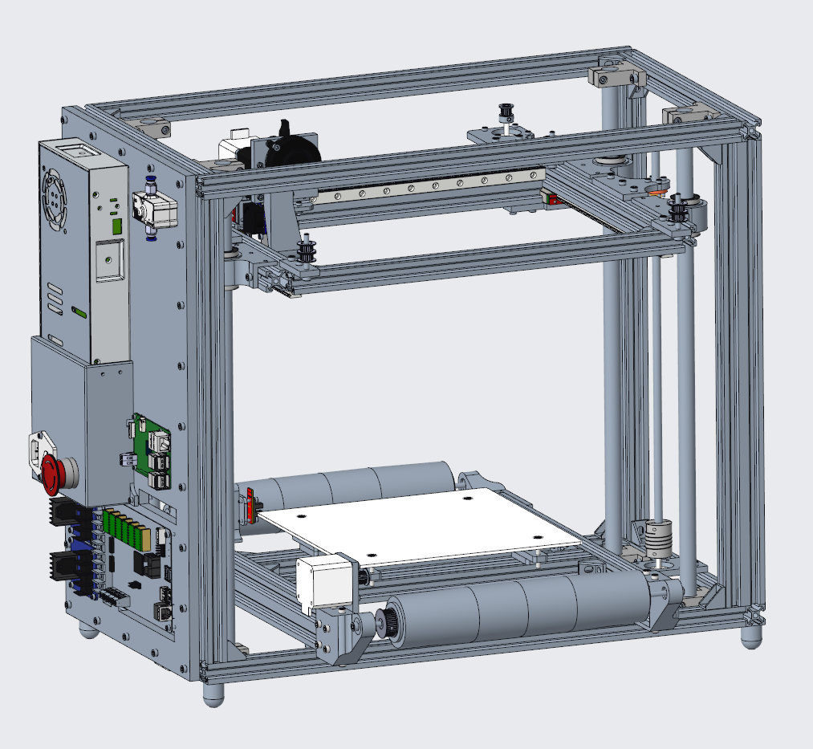
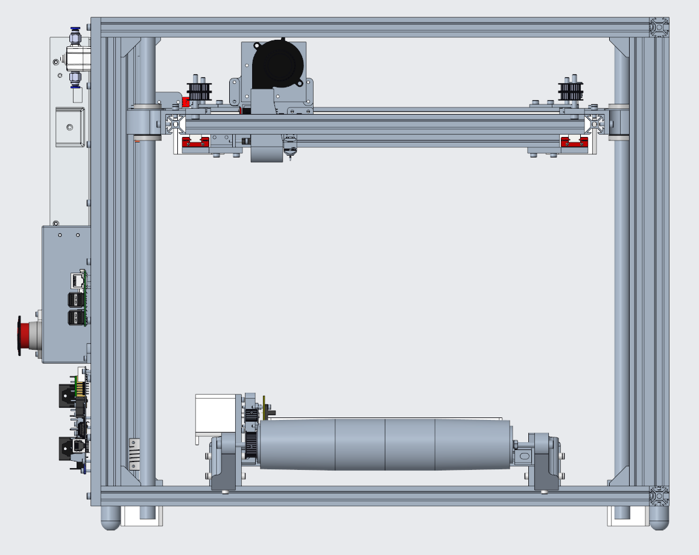
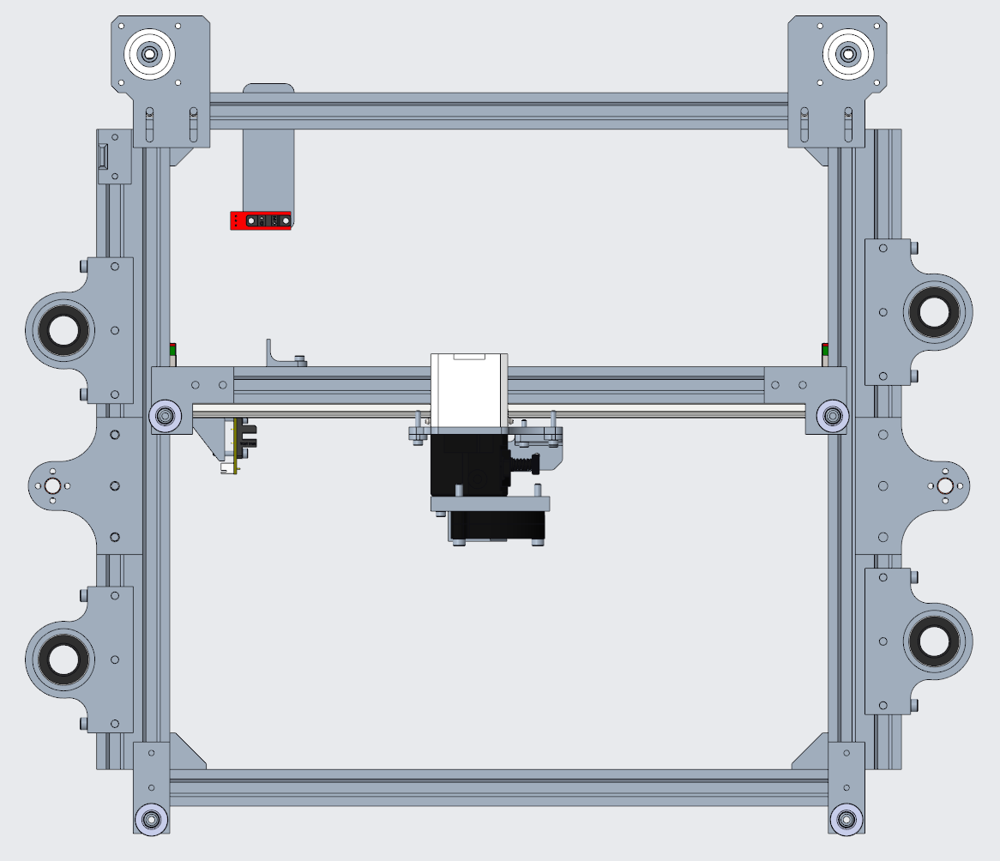
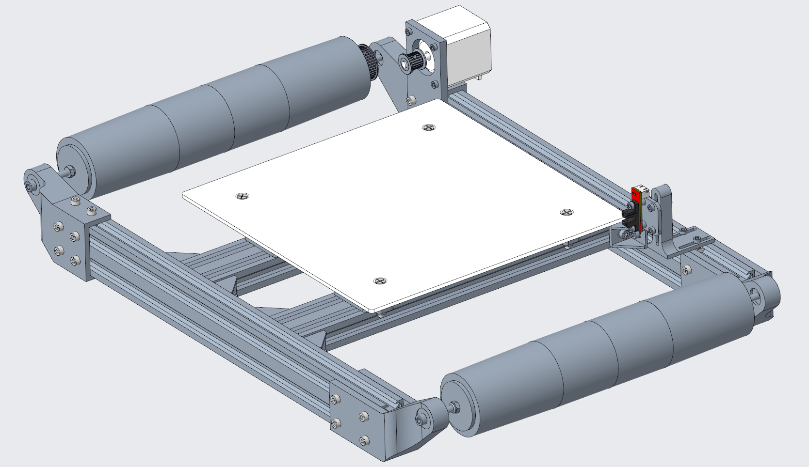
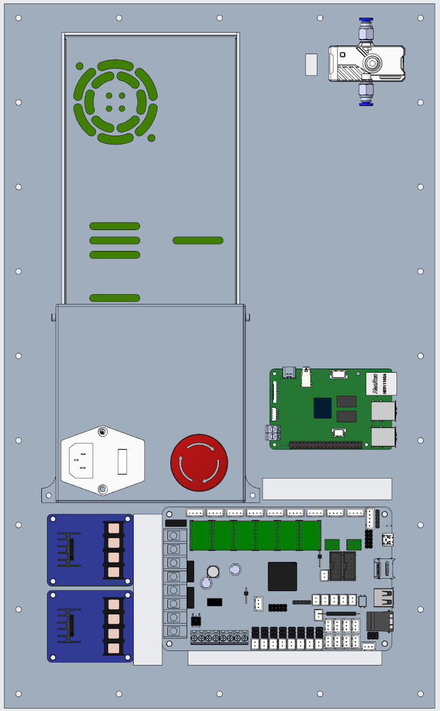

# Celeauprinter-10

**Continuous 3D printer featuring a flying CoreXY Z-gantry, conveyor belt bed for serial production.**

  

> **Who is this for?** This project is aimed at **experienced makers and engineers**. This README documents key architectural choices, manufacturing constraints, and design points, but assumes **mechanical common sense and hands-on DIY experience**. It is not a beginner step-by-step kit tutorial. For exact component positioning and clearances, refer directly to the master assembly STEP file in [`CAD/STEP/celeauprinter_10.stp`](CAD/STEP/celeauprinter_10.stp).

---

## Table of Contents

- [Overview](#overview)
- [Gallery](#gallery)
- [Specifications](#specifications)
- [Bill of Materials (BOM)](#bill-of-materials-bom)
- [Tools](#tools)
- [Manufacturing](#manufacturing)
- [Assembly](#assembly)
- [Electronics and Wiring](#electronics-and-wiring)
- [Software and Firmware](#software-and-firmware)
- [Coming Soon](#coming-soon)
- [License](#license)

---

## Overview

The **CeleauPrinter-10** is an open-access additive manufacturing machine engineered for **continuous small-batch production**. It decouples part mass from dynamic motions through a non-translating, conveyor-driven build surface coupled with a flying toolhead gantry.

- **Kinematics**: **Flying CoreXY gantry** handling X, Y, and Z motion. The frame travels vertically along 16 mm hardened shafts driven by dual lead screws, carrying the full CoreXY plane.
- **Static bed with automated ejection**: The heated bed does not move in 3D space. It is wrapped in a high-temperature conveyor belt driven by an independent stepper motor, allowing parts to clear the print surface automatically after cooling.
- **Industrial feed**: Designed without a frame-mounted spool holder. The system interfaces directly with active multi-kilo filament dryers to feed large 5 kg industrial spools.
- **Electronics bay**: Integrated side-mounted power panel hosting industrial safety mechanisms, dedicated high-power MOSFETs, and isolated control boards.

All design files, bills of materials, and assembly documentation are open for personal and maker replication.

---

## Gallery

### CAD Assembly Overview

| Isometric view | Front view |
| :---: | :---: |
|  |  |

### Subsystems

| Flying CoreXY gantry | Conveyor bed assembly | Electronics panel |
| :---: | :---: | :---: |
|  |  |  |

---

## Specifications

| Item | Detail |
| :--- | :--- |
| **Kinematics** | Flying CoreXY Z-gantry (X, Y, and Z on toolhead assembly) |
| **Build volume (X × Y × Z)** | ~220 × 220 × ~250 mm (standard bed footprint, infinite ejection axis) |
| **Motion system** | MGN12H linear rails on X/Y, dual 16 mm linear shafts (SK16 / LM16UU) on Z |
| **Bed system** | Static flat bed with continuous conveyor belt and NEMA 17 drive |
| **Extrusion** | All-metal BMG dual-drive extruder, direct-drive configuration |
| **Filament management** | BTT SFS V2.0 smart filament sensor, tuned for 5 kg spools via active dryer |
| **Control electronics** | BigTreeTech Octopus V1.0 + SBC host (Raspberry Pi or compatible) |
| **Power and safety** | Industrial power supply, external dual MOSFET switches, rotary emergency stop (E-stop) |
| **Frame construction** | T-slot aluminum extrusions (2020 / 2040) with custom structural ASA brackets |
| **Firmware** | Klipper + Moonraker + Mainsail / Fluidd |

---

## Bill of Materials (BOM)

The complete procurement list is available in **[`BOM.md`](BOM.md)**. It covers:

1. **Fasteners**: Metric socket head screws (M3, M4, M5), T-slot nuts, hex nuts, and spacers.
2. **Brackets and structural hardware**: Standard off-the-shelf 2020 angle brackets.
3. **Extrusions**: Pre-cut aluminum profiles forming the base, pillars, and moving gantry.
4. **Motion components**: 16 mm linear shafts, MGN12 linear rails, pulleys, couplers, and lead screws.
5. **Actuators and sensing**: 6 NEMA 17 stepper motors, optical endstops, and BLTouch bed probe.
6. **Electronics and power**: BTT Octopus V1.0, external MOSFET modules, E-stop switch, and AC inlet.
7. **Custom printed parts**: Functional brackets, spacers, motor mounts, and segmented roller assemblies.

> **Note on custom parts**: Items labeled `CELEAUTECH` in the BOM are custom-designed parts to be fabricated by the builder. Items marked `ORIGINAL_FILE_LICENSE` are standard COTS components.

> **Pending cut-to-length items**: Drive belts, the conveyor belt loop, and exact PTFE tube lengths are temporarily excluded from the BOM tables. These dimensions will be finalized and updated on the machine directly during prototype assembly.

---

## Tools

### Machines required

| Machine | Used for |
| :--- | :--- |
| **FDM 3D printer** (enclosed recommended) | Custom brackets, supports, and rollers in ASA / TPU |
| **Laser cutter or CNC router** | Electronics mounting plate (`ELECTRONICS_PANEL`) in MDF or aluminum |

The structural printed parts are designed for high mechanical and thermal rigidity. An enclosed printer is strongly recommended to process technical materials without warping.

### Hand tools

- Metric hex key set (1.5 mm, 2.0 mm, 2.5 mm, 3.0 mm, 4.0 mm)
- Precision calipers and square ruler
- Wire strippers, crimping tool (JST-XH, Dupont, and ferrule terminals)
- Soldering iron and heat shrink tubing
- Threadlocker (medium strength) for motion-assembly fasteners
- Flat metal file (for customized clearance brackets)

---

## Manufacturing

### What the CAD files contain

The CAD data is organized in the [`CAD/`](CAD/) directory:

- **`CAD/STEP/`**: Contains the master 3D assembly (`celeauprinter_10.stp`). Import this file into any CAD software (SolidWorks, Fusion 360, FreeCAD) to inspect fits, clearances, and fasteners.

> **Fabrication files availability**: Individual `.3mf` print files and `.dxf` cutting profiles are temporarily withheld from this repository. To guarantee that community members only fabricate reliable parts, manufacturing files will be committed as soon as each part is validated on the physical prototype.

### 3D printing guidelines

All parts marked `CELEAUTECH` in the BOM must be printed with appropriate functional materials:

- **Structural parts and motor mounts**: Print in **ASA** (or ABS) for temperature resistance, dimensional stability, and rigidity. Use 4 perimeters with at least 40% infill.
- **Machine feet**: Print in **TPU 64D** (recommended) or **TPU 95A** with dense infill to isolate frame vibrations.
- **Rollers**: Print the segmented cylinder shells (`CONE_ROLL`) with concentric top/bottom layers to maximize surface smoothness and belt contact.

---

## Assembly

Detailed assembly guides are divided into dedicated documents in the [`docs/`](docs/) directory:

- **[`docs/01_mechanics.md`](docs/01_mechanics.md)**: Frame squaring, linear rail installation, flying Z gantry alignment, and conveyor bed tensioning.
- **[`docs/02_electronics.md`](docs/02_electronics.md)**: Side-panel component placement, high-voltage isolation, dual MOSFET wiring, and logic connections.
- **[`docs/03_software.md`](docs/03_software.md)**: Klipper firmware flashing for BTT Octopus, pin assignments, kinematics configuration, and automated bed ejection macros.
- **[`docs/04_first_print_ops.md`](docs/04_first_print_ops.md)**: Motion checks, sensorless/optical homing calibration, PID tuning, and automated production cycles.

> **Work in progress**: The documentation files currently contain structural placeholders. They will be completed step by step as the physical build progresses.

---

## Electronics and Wiring

  

The electronics bay is grouped onto a single side panel for easy maintenance and wiring isolation:

- **Mains AC**: Fused IEC input with integrated master power switch, routed directly through the rotary emergency stop (E-stop) switch before feeding the industrial power supply.
- **Power separation**: The main DC power supply directly powers external high-power MOSFET modules. High current for heating elements bypasses the controller board logic traces to prevent thermal degradation.
- **Logic control**: BigTreeTech Octopus V1.0 driven by an external SBC host via internal USB or serial connection.
- **Filament path sensing**: BTT Smart Filament Sensor V2.0 mounted directly near the toolhead inlet for real-time clog and runout detection.

> **High-Voltage Safety Notice & Disclaimer**:  
> This build involves working with **mains alternating current (110 V / 230 V AC)**, which carries severe risks of electric shock, serious personal injury, or fire hazard if handled incorrectly.  
> 
> Although custom protective covers (such as `POWER_SUPPLY_CARTER`) have been engineered into this design to prevent direct finger access to live terminals once fully assembled, **proper execution, insulation, wire gauge sizing, crimping, grounding, and fusing remain the sole responsibility of the builder**.  
> 
> **CeleauTech (Antoine Navarro EI) assumes no liability or responsibility** for any personal injury, electrical shock, electrocution, property damage, equipment failure, or fire resulting from the construction, wiring, modification, or operation of this machine. If you are not experienced or certified in mains electrical work, seek assistance from a qualified electrician before applying power. Always ensure the aluminum frame is bonded to protective earth (PE) and completely disconnect the machine from the wall outlet before servicing.

---

## Software and Firmware

### Klipper Ecosystem

The machine is driven by **Klipper**, configured for automated ejection queues:

1. **Kinematics definition**: CoreXY geometry running on the moving Z plane, with independent Z motor drivers synchronized through dual lead screws.
2. **Bed conveyor axis**: Driven as an auxiliary stepper motor (`[manual_stepper convoyeur]`), indexed via Klipper macros to feed the continuous loop forward upon print completion.

### Automated Serial Production: Print Series Generator

Continuous part clearing is orchestrated using a dedicated companion desktop utility developed for this platform:

**[Series-3D-printing-sequencer](https://github.com/Celeautech-Lab/Series-3D-printing-sequencer)**

The software is source-available and free for personal/non-commercial use under the PolyForm Noncommercial 1.0.0 license. Pre-compiled standalone executables requiring no Python setup are available on its [Releases page](https://github.com/Celeautech-Lab/Series-3D-printing-sequencer/releases) for **Windows**, **Linux**, and **macOS (Apple Silicon)**.

Key capabilities:
- Processes standard sliced G-code files tagged with clean `; BODYSTART` and `; BODYEND` boundary comments.
- Parses batch schedules (`serie.csv`) to define sequential queues, individual part ranks, and cycle repetitions.
- Automatically inserts an inter-part transition block (cooling dwell, bed conveyor advance macro, and axis re-homing) between each printed object.
- Generates a single compiled, multi-part production G-code file configured for continuous, unattended execution.

---

## Coming Soon

- [ ] Complete fabrication release: verified `.3mf` files for all printed brackets and `.dxf` panels for laser cutting.
- [ ] End-to-end assembly documentation across all four manuals in [`docs/`](docs/).
- [ ] Validated belt lengths and cut-to-size specifications in `BOM.md`.
- [ ] Stock Klipper configuration files (`printer.cfg`) with automated queue macros.
- [ ] Physical build photo gallery and continuous print demo videos.

---

## License

This repository follows a multi-tier licensing model:

- **Custom CeleauTech Hardware Files (`CELEAUTECH` in BOM)**:  
  All custom 3D models, brackets, mechanical drawings, and documentation created by CeleauTech are released under the **[Creative Commons Attribution-NonCommercial 4.0 International License (CC BY-NC 4.0)](LICENSE)**.  
  You are free to build and modify this machine for personal, educational, and non-commercial purposes. Any commercial use, sale of kits, pre-printed part bundles, or assembled units requires prior written agreement.
- **Third-Party CAD Models (`ORIGINAL_FILE_LICENSE` in BOM)**:  
  Standard COTS components (fasteners, extrusions, motors, linear guides, controller boards) integrated into the master STEP assembly remain subject to their respective original licenses and source distributions.
- **Firmware Configurations and Macros (`Public Domain / CC0`)**:  
  All Klipper configuration files, macros, and slicer profiles are released into the public domain without restrictions.

For commercial licensing, kit manufacturing, or partnerships:  
**Antoine Navarro EI (CeleauTech)** — [celeautech.contact@gmail.com](mailto:celeautech.contact@gmail.com)

---

  Designed and built by <b>CeleauTech</b> 
  If you find this design interesting or useful, feel free to star the repository and follow the build progress.

