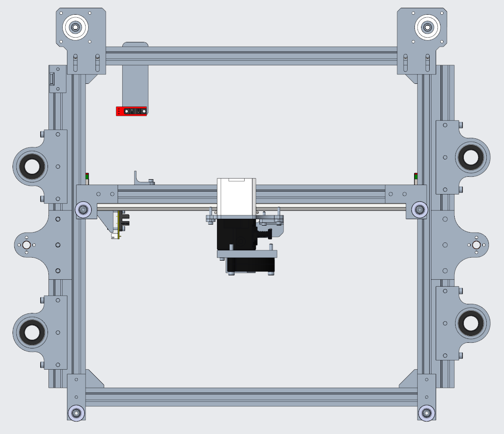
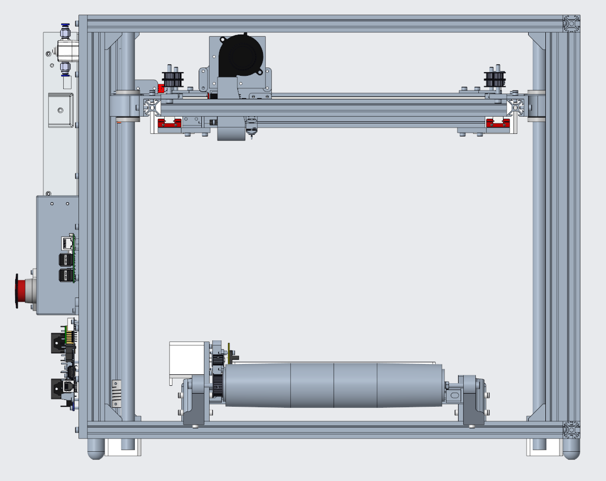
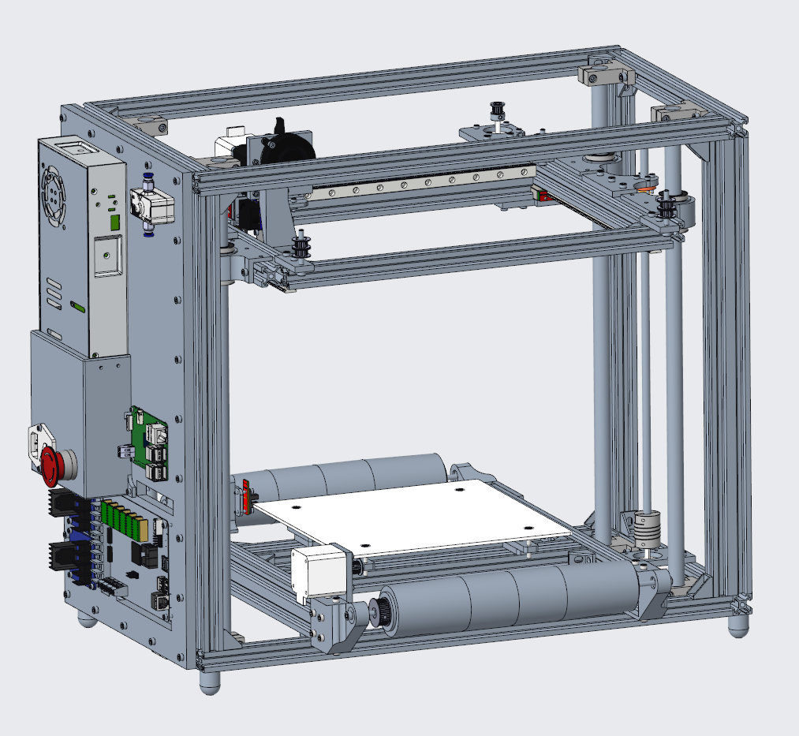
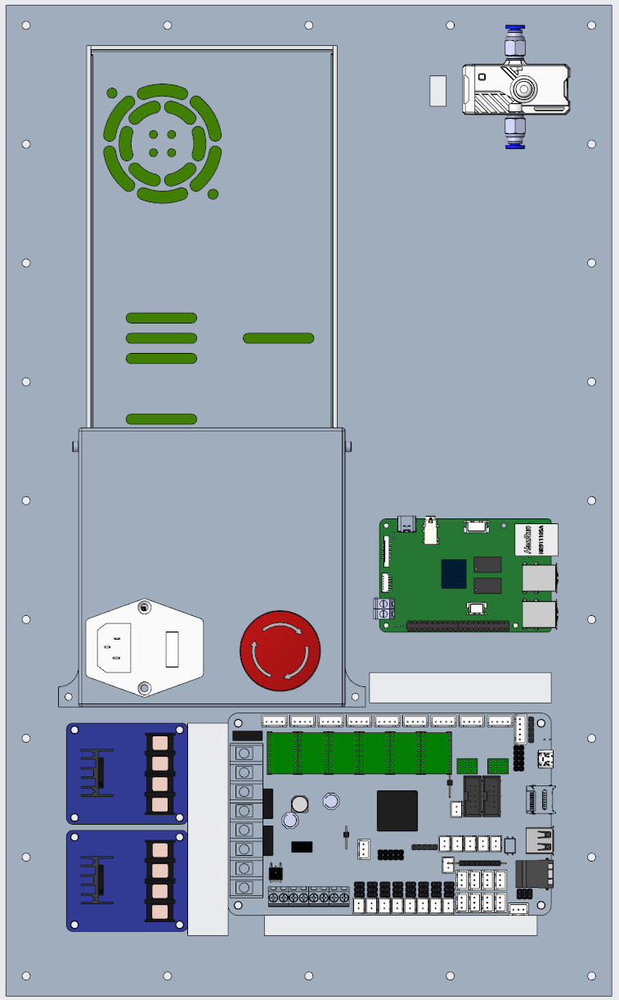

# 01 — Mechanical Assembly

> **Target audience:** Experienced makers and engineers. This guide outlines the assembly sequence and key mechanical checkpoints. For exact clearances, fastener lengths, and component orientations, refer directly to the master CAD assembly in [`../CAD/STEP/celeauprinter_10.stp`](../CAD/STEP/celeauprinter_10.stp).

---

## Key Mechanical Architecture

- **Kinematics:** Flying CoreXY gantry (X, Y, and Z motion on the moving toolhead frame).
- **Z-Axis:** Dual 16 mm hardened linear shafts (`SK16` / `LM16UU`) driven by dual lead screws.
- **X/Y-Axis:** `MGN12H` linear rails.
- **Bed:** Continuous conveyor belt bed *(Work in Progress — mechanical assembly incomplete, not yet tested or printed on)*.

---

## Assembly Sequence

### Step 1 — Flying CoreXY Z-Gantry

Assemble the moving CoreXY frame as a standalone sub-assembly before integrating it into the main chassis.

  

- Square the 2020 extrusion frame on a flat reference surface before tightening corner brackets.
- Mount the `MGN12H` linear rails and verify smooth carriage travel without binding.
- Install the X/Y stepper mounts, idler pulleys, and `LM16UU` linear bearings according to [`celeauprinter_10.stp`](../CAD/STEP/celeauprinter_10.stp).
- Use medium-strength threadlocker on all motion-critical fasteners.

---

### Step 2 — Conveyor Belt Bed Assembly *(Work in Progress)*

> **Status:** Assembly incomplete. No prints have been made on the conveyor bed yet. Refer to [`celeauprinter_10.stp`](../CAD/STEP/celeauprinter_10.stp) for the current design intent. Detailed assembly steps, belt tensioning procedures, and validation notes will be added once the physical mechanism is finalized and tested.

---

### Step 3 — Main Chassis & Gantry Integration

Build the base and vertical pillars, then drop the flying CoreXY gantry onto the Z-axis shafts.

| Main Chassis — Front View | Completed Chassis — Isometric View |
| :---: | :---: |
|  |  |

- Square the main 2020/2040 extrusion frame and install the TPU feet.
- Mount the dual 16 mm Z-shafts (`SK16`) and Z lead screws.
- Lower the flying CoreXY gantry onto the 16 mm shafts and align the lead screw nuts.
- Verify that the gantry moves freely across the full Z travel without binding before locking down the shaft supports.

---

### Step 4 — Electronics Mounting Plate

Install the laser-cut/CNC-routed `ELECTRONICS_PANEL` on the side of the chassis.

  

- Mount the power supply, external MOSFETs, rotary E-stop, and BTT Octopus V1.0 onto the panel as shown in [`celeauprinter_10.stp`](../CAD/STEP/celeauprinter_10.stp).
- Ensure the `POWER_SUPPLY_CARTER` protective cover fits cleanly over the AC terminals.

---

## Navigation

- **Next:** [02 — Electronics and Wiring](02_electronics.md)
- **Back to:** [README](../README.md) | [BOM](../BOM.md)
